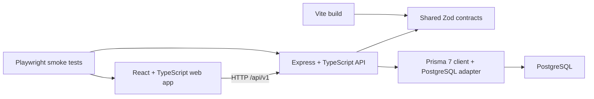

# Architecture

## Workspace boundaries

- `apps/web` owns browser routing, layout, environment parsing, and the typed fetch client. Only `VITE_` variables are exposed to browser code.
- `apps/api` separates application construction from process startup so HTTP behavior can be tested without opening a listening port. Middleware owns request IDs, security headers, CORS, rate limiting, structured logs, validation, and error responses.
- `apps/web/src/modules` and `apps/api/src/modules` hold cohesive feature modules. A module owns only the components it needs (for example routes, services, schemas, types, constants, and `__tests__`); cross-cutting configuration, transport middleware, and UI primitives remain outside feature modules.
- `packages/shared` publishes explicit ESM and declaration-file exports from its TypeScript build. Shared API contracts are organized by module and re-exported from the package root for stable consumption.
- `apps/api/prisma` holds the PostgreSQL schema, migrations, and TypeScript seed entrypoint. Prisma 7 uses a driver adapter and `prisma.config.ts`.
- `tests/e2e` separates browser and API specs and shares typed fixtures, page/API clients, steps, response factories, and parsing helpers. Database migrations are an explicit operator action, never a container startup side effect.

The current web `home` module and API `health` module demonstrate the pattern without adding task workflows. Components such as services, validation, or module-specific error types are added only when behavior needs them; unused placeholder files and empty folders are avoided.

## Runtime behavior

The API liveness endpoint confirms that the process is serving requests. The readiness endpoint performs a database query and returns 503 when PostgreSQL is not reachable. The initial Task table is a storage foundation only; no task routes or UI workflows are implemented.

All API errors use an `{ error: { code, message, requestId, details? } }` envelope. Successful JSON responses use `{ data }`. A validated incoming `X-Request-Id` is echoed; otherwise the API generates one and includes it in response headers, logs, and error envelopes.
